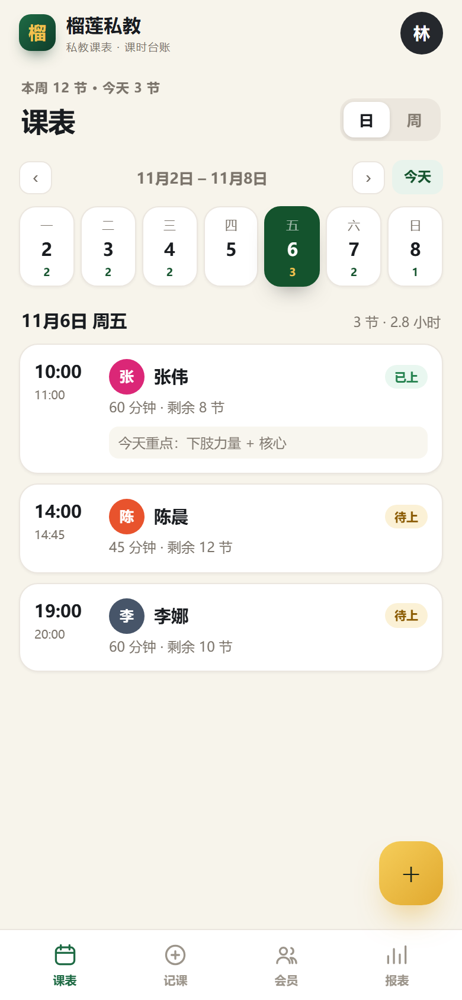
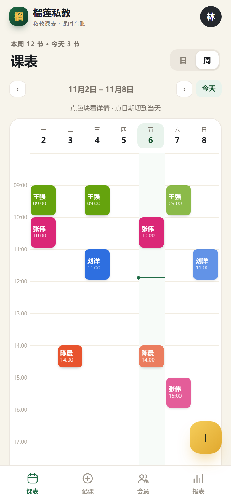
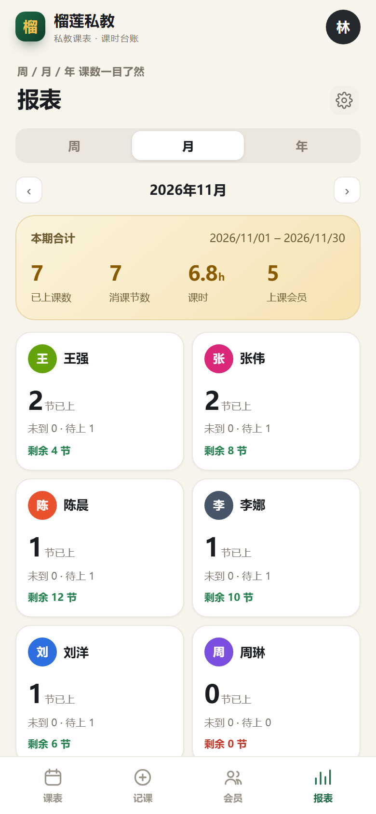
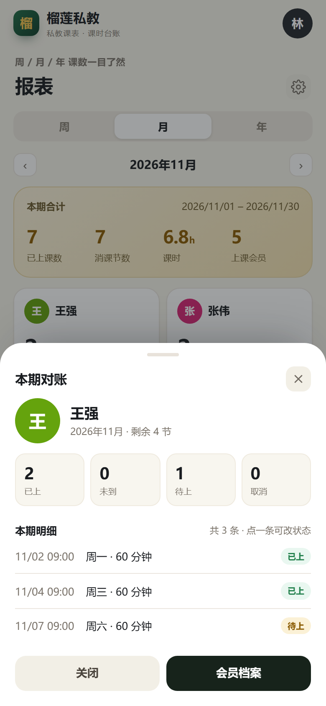

# 榴莲私教 · 手机端私教排课与课时台账

给自己用的私教排课小工具：**记课 → 看课表 → 按会员统计周/月/年课数 → 月底对账出表**。

纯前端、零依赖，数据存在手机浏览器本地；可以「添加到主屏幕」，用起来像 App。

**在线地址**：<https://fenglil401.github.io/paikebu/> —— 手机打开后可直接「添加到主屏幕」。


| 日课表 | 周课表 |
| --- | --- |
|  |  |

| 月底报表 | 本期对账 |
| --- | --- |
|  |  |

## 它解决什么

- **按时间记课**：会员名、日期、开始时间、时长、状态、备注，一节课一条记录；
- **方便看**：日视图是按时间排好的清单，周视图是 7 天 × 小时的时间网格，点色块直接看详情；
- **按会员统计**：每个人的本周、本月、今年课数同时可见；报表还能按周/月/年切换，看全店每个会员的课数；
- **月底对账**：点开某个会员，能看到这一期（周/月/年）的每一条上课记录，逐条核对、当场改状态；
- **出表**：一键导出本期上课明细 CSV 和会员课时汇总 CSV，Excel 直接打开；
- **课时台账**：剩余课时 = 已购 + 校正 − 已消，续课和校正都有记录，课数对不上时能查。

## 快速开始

1. **打开**：直接双击 `index.html`（电脑上演示），或者把整个 `schedule-book` 文件夹放到任意静态网站空间，用手机浏览器打开。
2. **装到手机桌面**：
   - iPhone Safari：分享 → 添加到主屏幕；
   - Android Chrome：菜单 → 添加到主屏幕 / 安装应用。
3. **开始用自己的数据**：首次打开是演示数据，进入「报表 → 右上角齿轮 → 清空全部数据」，然后添加会员、开始记课。

> 想在手机上先试用：在电脑上进入本文件夹执行 `python -m http.server 8080`，手机连同一个 Wi-Fi，访问 `http://电脑IP:8080` 即可（这种方式不注册离线缓存，正式用建议挂到 HTTPS 静态站点）。

## 五个常用动作

1. **添加会员**：会员 → 右上角「+ 添加」→ 姓名、手机号、初始课时。
2. **记一节课**：底部「记课」→ 选会员 → 选日期/时间/时长 → 选状态 → 保存。保存后自动跳到那天的课表。
3. **看课表**：底部「课表」→ 右上「日 / 周」切换；点课程色块可改时间、改状态或删除。
4. **月底对账**：底部「报表」→ 选周/月/年 → 点会员卡片 → 「本期对账」里逐条核对。
5. **出表给会员看**：报表底部「导出本期上课明细」或「导出会员课时汇总」。

## 状态与统计口径

| 状态 | 含义 | 计入课数 | 扣课时 |
| --- | --- | --- | --- |
| 待上 | 已预约，还没上 | 否 | 否 |
| 已上 | 正常完成 | 是 | 是 |
| 未到 | 会员没来 | 单列 | 默认扣，可在设置里关闭 |
| 取消 | 取消的预约 | 否 | 否 |

- **剩余课时** = 已购课时 + 校正 − 已消课（已上 + 未到按设置计不计）；
- **消课节数** = 已上 + 未到（未到计课时时）；
- **课时** = 消课节数对应的分钟数，按小时显示；
- 报表里的「已上」「未到」「待上」「取消」始终分开显示，方便对账。

## 月底课数对不上，怎么查

1. 报表选「月」，看每个会员的已上/未到/待上/取消；
2. 点会员卡片进「本期对账」，对照每一条记录的日期、时间、状态；
3. 记错了：点那条记录 → 改状态或时间 → 保存；
4. 漏记了：记课 → 日期选那一天 → 补录；
5. 会员的剩余课时有出入：会员档案 → **校正**，填 +/- 节数和原因（会留痕）；
6. 导出 CSV，发给会员或自己存档。

## 数据与备份

- 数据保存在当前浏览器的 `localStorage`（key：`paikebu-v1`），不上传服务器；
- **换手机、换浏览器、清理浏览器数据前，一定先导出备份**：设置 → 导出备份（JSON）；
- 恢复：设置 → 导入备份 → 选择 JSON 文件（会提示覆盖当前数据）；
- 备份文件可以放微信收藏、网盘，下次换设备导入即可。

```
{
  coach: { name, studio },
  settings: { countNoShow },
  members: [{ id, name, phone, total, adjust, note }],
  courses: [{ id, memberId, date, start, duration, status, note }],
  logs: [{ id, memberId, type: 'renew' | 'adjust', delta, reason, date }]
}
```

## 文件结构

```
schedule-book/
├─ index.html              页面骨架
├─ styles.css              全部样式（移动优先 + 桌面手机框）
├─ app.js                  数据、统计、页面、交互
├─ manifest.webmanifest    PWA 配置（可安装到桌面）
├─ sw.js                   离线缓存
├─ icons/                  应用图标
├─ preview/                手机截图
└─ README.md
```

## 装到手机上长期使用

选一个静态托管，把 `schedule-book` 整个文件夹传上去即可，不需要后端：

- **GitHub Pages**：新建仓库 → 上传文件 → Settings → Pages → 选分支 → 得到网址；
- **Vercel / Netlify**：把文件夹拖进网页即可部署；
- **腾讯云 COS / 阿里云 OSS**：开静态网站托管，上传文件，用默认域名访问。

部署后用手机打开网址 → 添加到主屏幕。PWA 的离线缓存需要 HTTPS（GitHub Pages、Vercel 默认都是）。

## 说明与限制

- 目前是**单教练、单门店**的模型：同一时间只能有一节课，排课时会自动检测时间冲突；
- 数据只在这台设备的浏览器里，**不云同步**；多台设备请用「导出/导入备份」搬数据；
- 没有登录、支付、上课提醒、会员端；这些需要后端或小程序能力；
- 演示数据按打开当天生成，可随时清空。

## 想自己改

- 可排课时间：`app.js` 顶部 `SLOT_FROM` / `SLOT_TO`，周视图每小时高度 `HOUR_H`；
- 状态文案与颜色：`STATUS`；
- 会员头像颜色：`COLORS`；
- 想改成微信小程序：页面结构可以直接映射成 WXML/WXSS，把 `localStorage` 换成 `wx.setStorageSync`，渲染函数基本可以复用。
